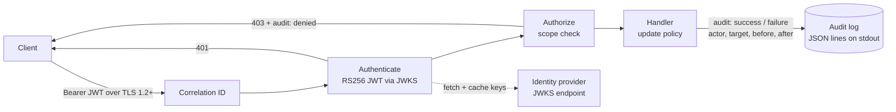

# go-secure-audit-api


A small Go REST API for backup retention policies, built to show the security controls a FedRAMP-style SaaS service needs **in code and in tests**. Those controls are stateless JWT validation against a JWKS endpoint, TLS 1.2+ with FIPS-approved ciphers, a FIPS 140-3 startup assertion, and structured audit events for every privileged action.



## What it does

| Control | Where | Proven by |
|---|---|---|
| Stateless JWT validation via JWKS, RS256 only, issuer, audience, `exp` required | `internal/auth` | `TestInvalidTokensAreRejected` (12 attack cases, including `alg: none` and HS256 algorithm confusion) |
| JWKS caching, with rate-limited refresh when a token names an unknown key | `internal/auth/jwks.go` | `TestKeysAreCachedNotFetchedPerRequest`, `TestUnknownKidRefreshIsRateLimited` |
| Scope-based authorization | `internal/api` | `TestMissingScopeIs403AndAuditedAsDenied` |
| Structured audit events: actor, target, before/after state, outcome, correlation ID | `internal/audit`, `internal/api` | `TestPrivilegedUpdateEmitsCompleteAuditEvent`, `TestConcurrentUpdatesAreAllAudited` (run with `-race`) |
| TLS 1.2+ only, ECDHE + AES-GCM suites, P-256/P-384 curves | `internal/tlsconfig` | `TestRejectsTLS11`, `TestRejectsNonAEADCipherOnTLS12` |
| FIPS 140-3 startup assertion: the service refuses to start if FIPS is required but not enabled | `internal/tlsconfig`, `cmd/server` | `TestAssertFIPS` + `scripts/fips-gate.sh` in CI |
| Refuses to run without TLS unless explicitly in dev mode | `cmd/server` | startup check |

## Run it locally (3 terminals)

```bash
make run-idp        # 1. fake identity provider: prints ADMIN_TOKEN and READER_TOKEN exports
make run            # 2. the API on http://localhost:8080 (dev mode, no TLS)

# 3. paste the two export lines from terminal 1, then:
curl -s -H "Authorization: Bearer $READER_TOKEN" localhost:8080/v1/policies/daily
curl -s -X PUT -H "Authorization: Bearer $READER_TOKEN" -d '{"retention_days":90}' localhost:8080/v1/policies/daily   # 403, audited as denied
curl -s -X PUT -H "Authorization: Bearer $ADMIN_TOKEN" -H "X-Correlation-ID: demo-1" \
     -d '{"retention_days":90,"immutable":true}' localhost:8080/v1/policies/daily                              # 200, audited with before/after
```

Terminal 2 prints audit events on stdout and application logs on stderr:

```json
{"time":"2026-09-28T17:41:23Z","type":"audit","action":"policy.update","actor":"alice@example.com","target":"policy/daily","before":{"id":"daily","retention_days":30,"immutable":true},"after":{"id":"daily","retention_days":90,"immutable":true},"outcome":"success","correlation_id":"demo-1","source_ip":"127.0.0.1"}
```

## Tests and CI

```bash
make race        # all tests with the race detector
make fips-test   # all tests with GODEBUG=fips140=on
make fips-gate   # a non-FIPS build must fail to start when REQUIRE_FIPS=true; a FIPS build must pass
```

The GitHub Actions pipeline runs format and vet checks, the race-detector tests, the FIPS-mode tests and the FIPS gate. It also runs `govulncheck`, then builds the container and fails on HIGH or CRITICAL Trivy findings.

## Configuration

| Variable | Purpose |
|---|---|
| `JWKS_URL` | Identity provider's JWKS endpoint (e.g. `https://login.microsoftonline.com/<tenant>/discovery/v2.0/keys`) |
| `TOKEN_ISSUER` / `TOKEN_AUDIENCE` | Expected `iss` and `aud` claims |
| `TLS_CERT_FILE` / `TLS_KEY_FILE` | Server certificate and key (required unless `ALLOW_INSECURE_HTTP=true`) |
| `REQUIRE_FIPS` | `true` makes startup fail unless the Go FIPS 140-3 module is active |
| `ADDR` | Listen address, default `:8443` |

## Design decisions

- **The algorithm is pinned to RS256.** If a validator trusts the token's `alg` header, an attacker can send `alg: none` or sign with HS256 using the public key as the secret. Both attacks have tests.
- **Signed assertions are stronger than client secrets.** This service only *validates* tokens. The same idea applies on the client side: a client that authenticates with a signed JWT assertion (private key) never sends its secret over the wire. That is why the key-pair approach is preferred over shared secrets.
- **Denials are audited, anonymous requests are not.** A denied request comes from a known identity trying something it may not do, which is a security signal. Unauthenticated noise goes to application logs instead.
- **Before and after state are captured inside the store's lock.** Under concurrent writes the audit trail stays consistent. `TestConcurrentUpdatesAreAllAudited` proves every prior state appears exactly once as a "before".
- **Audit and app logs are separate streams.** Audit events go to stdout as JSON lines and app logs to stderr, so a log pipeline can route audit events to long-term, tamper-resistant storage.

## Next steps

- Emit audit events to an OpenTelemetry Collector instead of stdout
- Add OAuth client-credentials with `private_key_jwt` for outbound service-to-service calls
- Replace the in-memory store with PostgreSQL and add integration tests
